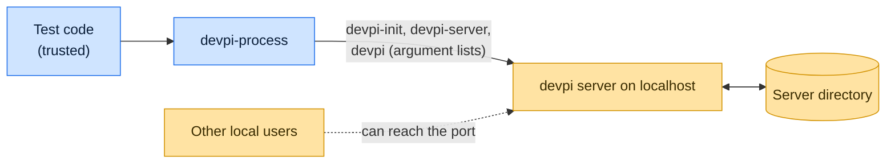

# Threat model

This model says what devpi-process trusts, where untrusted input enters, and which guarantees hold at each boundary, so
a report can be classified as a vulnerability or a bug. [SECURITY.md](SECURITY.md) covers reporting; if the two
disagree, SECURITY.md wins and we fix this file.

## How devpi-process works

`IndexServer(path)` runs `devpi-init` to initialize a server directory with a random root password, starts
`devpi-server` on a free port at its default host, `localhost`, and drives the `devpi` client to log in as root, create
indexes and upload distributions. The three programs come from the interpreter's scripts directory and run with argument
lists, never a shell. Upstream PyPI is off unless `with_root_pypi` is set. When the context manager exits, the server
process stops.

## Compared with similar tools

We drew the boundary where comparable projects in other ecosystems draw theirs. The shared rule, stated by the
[Node.js threat model](https://github.com/nodejs/node/blob/main/SECURITY.md#the-nodejs-threat-model), is that a report
which first needs a trusted element compromised is out of scope; the first triage question, as
[DOMPurify](https://github.com/cure53/DOMPurify/blob/main/SECURITY.md#what-we-consider-a-vulnerability) puts it, is what
the attacker controls.

| Project                                                                                 | Language   | Where it draws the line                                                                                                             |
| --------------------------------------------------------------------------------------- | ---------- | ----------------------------------------------------------------------------------------------------------------------------------- |
| [Verdaccio](https://github.com/verdaccio/verdaccio/security/policy)                     | JavaScript | Private registry; reports go through Snyk.                                                                                          |
| [distribution (registry)](https://github.com/distribution/distribution/security/policy) | Go         | The OCI registry used as a test fixture; private reports to its CNCF list.                                                          |
| [Vitest](https://github.com/vitest-dev/vitest/security/policy)                          | JavaScript | Trusts the developer, the config file, plugins and every project file; only reports that need no trusted element compromised count. |

## Trusted

An attacker who controls any of these already has what devpi-process could give them:

- The test code and every path, index name, argument and file it passes, `start_args` included.
- The devpi tools in the interpreter's scripts directory, and the packages uploaded.

## Untrusted inputs

| Input           | Comes from                            | What devpi-process guarantees                                                                         |
| --------------- | ------------------------------------- | ----------------------------------------------------------------------------------------------------- |
| Network clients | Anything that can connect to the port | The server listens on `localhost` unless `start_args` change it; uploads need the generated password. |

## Threats and controls

| STRIDE                 | Threat                                                 | Control                                                                            |
| ---------------------- | ------------------------------------------------------ | ---------------------------------------------------------------------------------- |
| Spoofing               | Another process logs in as root.                       | A random root password is generated for each server.                               |
| Information disclosure | Another local user reads the root password.            | Accepted risk: it is passed to `devpi-init` and `devpi login` on the command line. |
| Tampering              | Caller data injects shell syntax into a devpi command. | Programs run with argument lists, never a shell.                                   |

## Release chain

Releases run on the shared [tox-dev/github-workflows](https://github.com/tox-dev/github-workflows) pipeline. A release
App, not a person, pushes the release commit and tag; the build installs its tools from a hash-checked `pylock.toml`
resolved with a seven-day upload cooldown by default; PyPI receives the files through
[trusted publishing](https://docs.pypi.org/trusted-publishers/) with attestations, and the GitHub Release is immutable.
Every workflow pins third-party actions to a commit SHA.

## Vulnerability or bug

| Report                                                          | Verdict       | Why                                         |
| --------------------------------------------------------------- | ------------- | ------------------------------------------- |
| The server listens on `0.0.0.0` by default                      | Vulnerability | Exposes a test index to the network.        |
| An index name with `;` runs a shell command                     | Vulnerability | Arguments must stay data.                   |
| Another user on a shared CI host sees the root password in `ps` | Accepted risk | Documented below; use a single-user runner. |

## Severity

- **High:** a caller value runs as a shell command, or the server listens beyond localhost without `start_args` asking
  for it.
- **Medium:** server data written outside the caller's directory, or a program other than the devpi tools runs.
- **Low:** the server fails to stop, or leaves files behind, after the context manager exits.

## Accepted risks

- The root password is 8 letters from Python's `random`, and it is visible in the process list while `devpi-init` and
  `devpi login` run. devpi-process is for tests on single-user machines and CI runners.

## Keeping this current

Revisit this model when devpi-process gains a new input source, network access, a new way to run code, or a new place it
writes to, and whenever an advisory is published.
